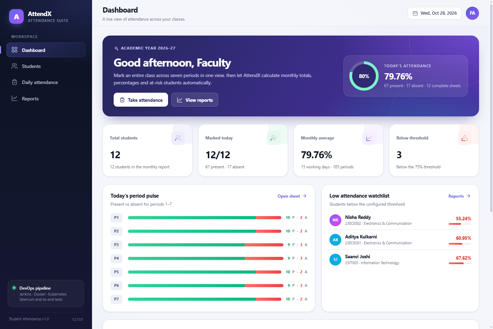
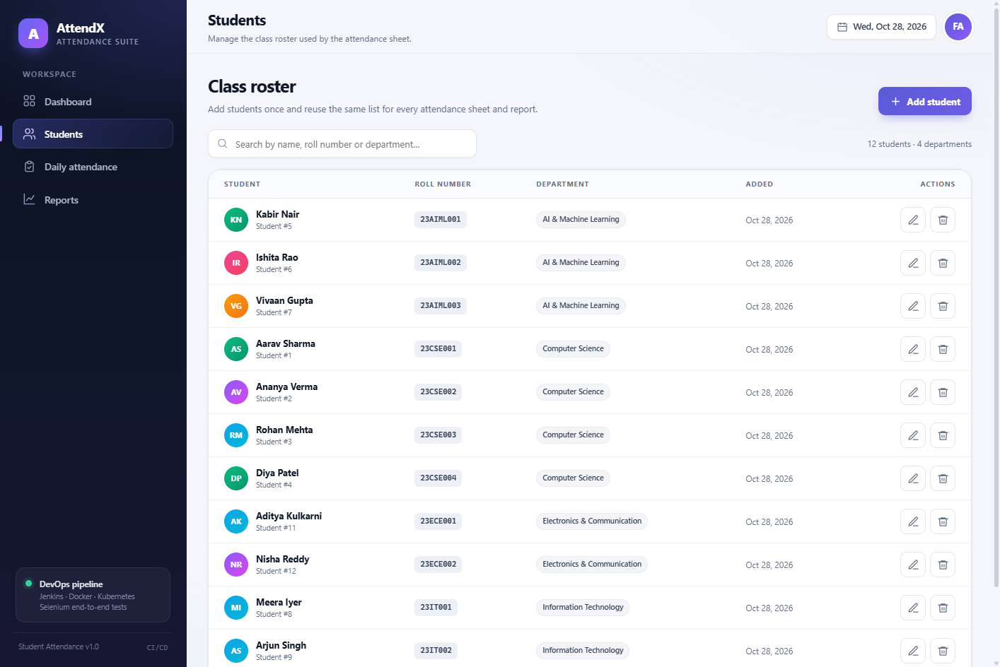
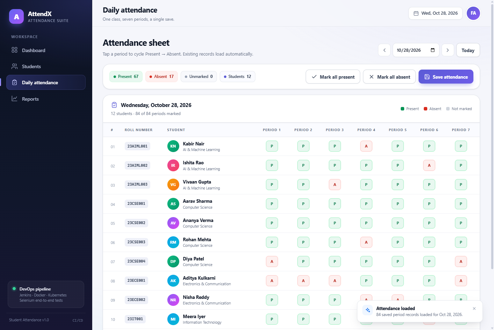
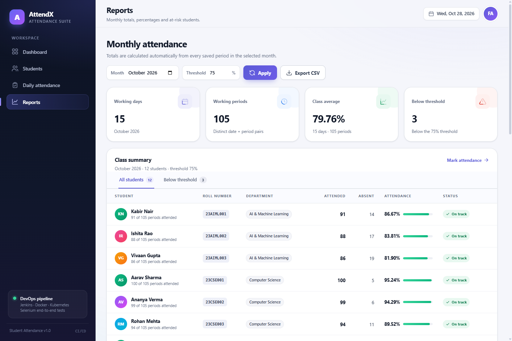
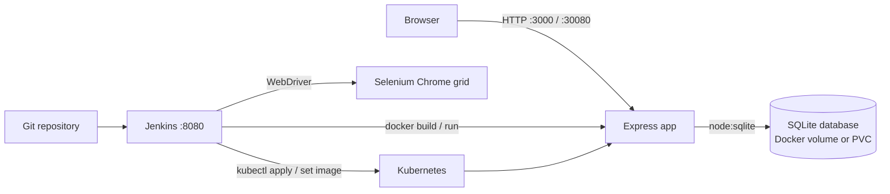

# AttendX — Student Attendance Management System Using DevOps Tools

A complete, working Student Attendance Management System with a full DevOps toolchain:
**Git/GitHub → Jenkins CI/CD → Docker → Kubernetes → Selenium WebDriver**.

The application is a Node.js 24 + Express service with a server-rendered vanilla JavaScript UI and a
SQLite database. It manages an entire class on a single attendance sheet, seven periods per day.



## Features

- **Whole-class attendance sheet** — every student on one page, periods 1–7 for the selected date.
- **Student management** — add, edit, search and delete students; roll numbers are unique
  (case-insensitive) and duplicates are rejected with a clear error.
- **Daily attendance** — mark present/absent per period, save the whole sheet in one request,
  reload it later, and correct it at any time.
- **Duplicate protection** — a database `UNIQUE (student_id, attendance_date, period)` constraint
  plus request validation prevents duplicate rows. Saving again updates the existing record.
- **Monthly analytics** — working days, working periods, attended periods, absent periods,
  attendance percentage, class average and a configurable low-attendance threshold.
- **Reports** — class report, below-threshold filter, daily history and per-student monthly detail.
- **CSV export** — UTF-8 (BOM) CSV with roll number, name, department, totals, percentage and
  threshold flag.
- **Dashboard** — today's attendance, period-by-period pulse, monthly average, low-attendance
  watchlist and recent days.
- **Responsive UI** — no CDN or external frontend dependency; works offline inside the container.
- **Automated tests** — 13 API tests and 9 Selenium UI tests, plus a persistence-after-restart test
  that covers the tenth documented end-to-end case.
- **CI/CD** — Jenkins pipeline builds the test image, runs API tests, builds the production image,
  runs Selenium against a real Chrome grid, and optionally deploys to Kubernetes.
- **Kubernetes** — namespace, ConfigMap, PVC, Deployment with probes and a NodePort Service.

| Students | Attendance sheet |
| --- | --- |
|  |  |

| Reports |
| --- |
|  |

## Architecture



**Runtime pieces**

| Component | Role |
| --- | --- |
| `attendance-app` | Node.js 24 / Express application, serves the UI and JSON API |
| `attendance-data` | Named Docker volume (Compose) or PVC (Kubernetes) for SQLite |
| `attendance-jenkins` | Jenkins LTS with Docker CLI, Compose plugin, kubectl and JCasC |
| `selenium-ci-<build>` | Ephemeral Selenium standalone Chrome container used by the pipeline |

## Technology stack

- **Backend:** Node.js 24, Express 4, built-in `node:sqlite` (no native module compilation)
- **Frontend:** semantic HTML, modern CSS, vanilla JavaScript
- **Database:** SQLite with WAL mode, foreign keys, indexes and a unique attendance key
- **Containers:** multi-stage Dockerfile, Docker Compose
- **CI/CD:** Jenkins LTS (JDK 21), Configuration as Code, Job DSL, Pipeline
- **Testing:** Node.js test runner, Selenium WebDriver 4, Selenium standalone Chrome
- **Orchestration:** Kubernetes (Docker Desktop Kubernetes / kind-compatible), Kustomize

## Quick start with Docker Compose (recommended)

### Prerequisites

- Windows 10/11 with WSL 2, or macOS/Linux
- Docker Desktop 4.x (Docker Engine 24+ and Compose v2+)
- Git
- About 4 GB of free RAM for the app + Jenkins + Selenium (8 GB recommended)

### Start the stack

```powershell
git clone <your-repository-url> student-attendance-devops
cd student-attendance-devops
docker compose up -d --build
```

Or use the helper script, which also waits for Jenkins:

```powershell
.\scripts\setup-jenkins.ps1
```

| Service | URL | Credentials |
| --- | --- | --- |
| AttendX | <http://localhost:3000> | none (demo app) |
| Jenkins | <http://localhost:8080> | `admin` / `admin123` |

The first Jenkins start can take 1–3 minutes while Configuration as Code creates the
`student-attendance-pipeline` job. Check progress with:

```powershell
docker compose ps
docker compose logs -f jenkins
```

### Stop / reset

```powershell
docker compose down            # stop containers, keep data
docker compose down -v         # stop and delete the SQLite + Jenkins volumes
```

## Run locally without Docker

Node.js **24 or newer** is required because the app uses the built-in `node:sqlite` module.

```powershell
npm install
npm run seed                   # optional demo data, idempotent
npm start                      # http://localhost:3000
```

Useful scripts:

```powershell
npm run dev                    # watch mode
npm run test:api               # 13 API tests
npm run test:selenium          # 9 Selenium UI tests (needs Chrome or SELENIUM_REMOTE_URL)
npm test                       # API + Selenium
```

For a remote Selenium grid:

```powershell
$env:BASE_URL = 'http://localhost:3000'
$env:SELENIUM_REMOTE_URL = 'http://localhost:4444/wd/hub'
npm run test:selenium
```

## Jenkins CI/CD

The Jenkins image is built from `jenkins/Dockerfile` and includes:

- Docker CLI and Compose plugin (talks to the host Docker socket)
- `kubectl`
- Git, jq, curl
- Jenkins plugins: Configuration as Code, Job DSL, Pipeline, Git, Matrix Auth,
  Pipeline Stage View, Timestamper, Workspace Cleanup
- `jenkins/casc/jenkins.yaml` — creates the admin user and the pipeline job automatically

Trigger the pipeline:

```powershell
.\scripts\trigger-jenkins.ps1
```

The pipeline runs these stages:

1. **Checkout** — clone the repository from the mounted path.
2. **API tests** — build `Dockerfile.test` and run the 13 API tests.
3. **Build application image** — build `student-attendance:<build>` and `:latest`.
4. **Selenium E2E** — start the app and a Selenium Chrome container on an isolated Docker
   network, wait for both, then run the 9 UI tests.
5. **Deploy to Kubernetes** — if `kubectl` can reach a cluster, import the build image into the
   kind node, apply `k8s/`, set the new image, wait for the rollout and smoke-test the Service.

Jenkins is a demo installation: it runs as `root` so it can access
`/var/run/docker.sock`. See the security notes before exposing it.

## Kubernetes deployment

Enable **Settings → Kubernetes → Enable Kubernetes** in Docker Desktop, wait for the cluster to
become green, then:

```powershell
# Build the image used by the manifests
docker build -t student-attendance:latest .

# Make the image visible to the Docker Desktop Kubernetes node (kind-based)
.\scripts\load-image-k8s.ps1 -Image student-attendance:latest

.\scripts\deploy-k8s.ps1

# Docker Desktop does not publish NodePorts to Windows; forward it locally
.\scripts\port-forward-k8s.ps1
```

Open <http://localhost:30080> while the port-forward is running. The Deployment uses one replica and
`Recreate` because SQLite is a single-writer database, and the PVC keeps data across pod restarts.
Jenkins needs `.\scripts\sync-kubeconfig.ps1` after a Docker Desktop restart; `setup-jenkins.ps1`
and `trigger-jenkins.ps1` run it automatically.

```powershell
kubectl -n student-attendance get pods,svc,pvc
kubectl -n student-attendance logs deployment/attendance-app
kubectl -n student-attendance rollout status deployment/attendance-app
```

Delete the deployment (this also deletes the namespace and its PVC, so back up first):

```powershell
kubectl delete -k k8s/
```

## The ten Selenium test cases

The first nine cases are implemented in `tests/selenium.test.js` and run against a real Chrome
browser. Case 10 is implemented as a server-restart persistence test in `tests/api.test.js`, so it
is deterministic in CI (it restarts the Node process and verifies the SQLite file).

| # | Test case | Implementation |
| --- | --- | --- |
| 1 | Display all registered students on the attendance page | `1. displays all registered students...` |
| 2 | Mark all seven periods and save attendance | `2. marks attendance for all seven periods...` |
| 3 | Reload saved attendance for the selected date | `3. reloads saved attendance...` |
| 4 | Validate missing and duplicate student information | `4. handles missing and duplicate student information` |
| 5 | Prevent duplicate attendance entries | `5. prevents duplicate attendance entries` |
| 6 | Calculate monthly attended/absent totals | `6. calculates monthly attendance totals correctly` |
| 7 | Display the correct attendance percentage | `7. displays the attendance percentage correctly` |
| 8 | Identify students below the configured threshold | `8. identifies students below the configured threshold` |
| 9 | Generate the monthly report and export CSV | `9. generates the monthly report and exports CSV` |
| 10 | Records remain available after an application restart | `Persistence across application restarts` in `tests/api.test.js` |

## API overview

| Method | Endpoint | Purpose |
| --- | --- | --- |
| `GET` | `/api/health` | Service and database health |
| `GET` | `/api/students?q=` | List/search students |
| `POST` | `/api/students` | Create a student |
| `PUT` | `/api/students/:id` | Update a student |
| `DELETE` | `/api/students/:id` | Delete a student and their attendance |
| `GET` | `/api/attendance?date=YYYY-MM-DD` | Load a day's sheet |
| `POST` | `/api/attendance` | Save/correct a day's records |
| `GET` | `/api/attendance/history?month=YYYY-MM` | Daily history for a month |
| `GET` | `/api/reports/monthly?month=YYYY-MM&threshold=` | Class monthly report |
| `GET` | `/api/reports/monthly.csv?month=YYYY-MM&threshold=` | CSV export |
| `GET` | `/api/reports/student/:id?month=YYYY-MM` | Student monthly detail |
| `GET` | `/api/settings` | Read threshold |
| `PUT` | `/api/settings` | Update threshold (0–100) |
| `GET` | `/api/dashboard?date=&month=` | Dashboard aggregate |

## Configuration

| Variable | Default | Description |
| --- | --- | --- |
| `PORT` | `3000` | HTTP port |
| `DB_PATH` | `./data/attendance.db` | SQLite file path |
| `SEED_DEMO` | unset | `true` seeds 12 students and 15 weekdays of demo attendance |
| `NODE_ENV` | `development` | Set to `production` in containers |
| `BASE_URL` | `http://localhost:3000` | Selenium target URL |
| `SELENIUM_REMOTE_URL` | unset | Selenium Grid/standalone endpoint |
| `KUBE_CONFIG_DIR` | `./.kube` | Jenkins-compatible kubeconfig directory (generated by `sync-kubeconfig.ps1`) |

## Project layout

```text
.
├── src/                    Express app, routes, services, SQLite schema, seed
├── public/                 Dashboard, students, attendance, reports UI
├── tests/                  API + Selenium tests and helpers
├── Dockerfile              Production multi-stage image
├── Dockerfile.test         Test image (API + Selenium suites)
├── docker-compose.yml      App + Jenkins stack
├── Jenkinsfile             CI/CD pipeline
├── jenkins/                Custom Jenkins image, plugins, JCasC
├── k8s/                    Namespace, ConfigMap, PVC, Deployment, Service
├── scripts/                PowerShell setup/run/trigger/deploy/smoke/K8s helpers
│   ├── setup-jenkins.ps1
│   ├── trigger-jenkins.ps1
│   ├── enable-k8s.ps1
│   ├── sync-kubeconfig.ps1
│   ├── load-image-k8s.ps1
│   ├── deploy-k8s.ps1
│   ├── port-forward-k8s.ps1
│   ├── smoke-test.ps1
│   └── run-local.ps1
└── docs/                   DevOps guide and screenshots
```

## Documentation

- **[docs/DEVOPS_GUIDE.md](docs/DEVOPS_GUIDE.md)** — step-by-step installation of Docker Desktop,
  Jenkins, Kubernetes; running the stack; pipeline details; Selenium grid; troubleshooting;
  security hardening.

## Security notes

This repository is a teaching/demo project. Before using it outside a lab:

- Change the Jenkins admin password and remove the demo credentials from `jenkins/casc/jenkins.yaml`.
- Do not expose Jenkins with the Docker socket mounted. Use a dedicated agent, rootless Docker,
  or a separate build node.
- Put the app behind a reverse proxy with TLS and authentication; the app itself has no login.
- Do not run SQLite with multiple replicas. Keep `replicas: 1` and `Recreate`, or migrate to a
  server database for horizontal scaling.
- Pin image tags and plugin versions, enable Jenkins CSRF protection (it is on by default), and
  back up the `attendance-data` and `jenkins-home` volumes.
- Use Kubernetes Secrets for credentials instead of ConfigMaps/plain environment variables.

## License

MIT — free to use for learning and academic projects.
